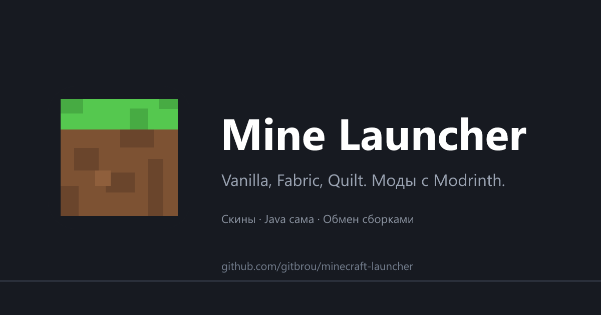

<div align="center">




# Mine Launcher

Лаунчер Minecraft, который не мешает играть: изолированные сборки, моды из Modrinth в два клика,
автоустановка Java и автоматические обновления самого лаунчера.

</div>

## Что умеет

- **Сборки (instances)** — каждая сборка изолирована: свои миры, моды и файлы игры. Переименование двойным кликом, поиск, честная дата «последнего запуска».
- **Загрузчики** — Vanilla, Fabric, Quilt. Forge — в планах.
- **Моды одной кнопкой** — поиск и установка с [Modrinth](https://modrinth.com) под вашу версию и загрузчик; включение/отключение/удаление. Ванилла честно предупредит, что моды не загрузятся.
- **Сборки в zip** — экспорт одним кликом: друг получает архив с модами и `instance.json`, импортирует его из лаунчера. Импорт валидирует архив (защита от zip-slip и zip-bomb, лимиты размера) и не затирает существующие сборки — добавляет «(2)».
- **Java не нужна** — лаунчер находит установленную Java или сам скачивает [Temurin JRE](https://adoptium.net) нужной мажорной версии (8/17/21 — по версии игры).
- **Автообновления лаунчера** — в собранной версии лаунчер сам проверяет GitHub Releases (при старте и раз в 4 часа), скачивает апдейт и ставит его; перед выходом достаточно нажать «Перезапустить и обновить» в баннере.
- **Понятные краши** — при падении игры лаунчер разбирает лог и пишет человеческую причину: не хватает памяти, не та Java, отсутствует VC++ Redistributable, блочится CDN ресурсов Mojang и т.д.
- **Рамка памяти по ОЗУ** — значение по умолчанию зависит от реального объёма памяти ПК; предупреждение, если накрутить больше физической.
- **Трей и один экземпляр** — окно может прятаться в трей во время игры; второй запуск лаунчера просто показывает существующее окно.
- **Скины с 3D-просмотром** — загрузите PNG или подтяните скин по нику.
- **Логи** — живой вывод игры с цветами, копирование одной кнопкой, прогресс скачивания в МБ/с.
- **Анимации** — сдержанные появления списков, модалок и прогресса; уважается `prefers-reduced-motion`.

## Требования

- Windows 10/11 (сборка NSIS/portable), Linux (AppImage), macOS (dmg, только из исходников).
- Ничего ставить не нужно: Java и файлы игры лаунчер скачает сам.

## Запуск из исходников

```bash
cd mine-launcher

npm install      # зависимости
npm run dev      # режим разработки
npm run compile  # typecheck + продакшн-сборка (dist/, dist-electron/)
npm test         # юнит-тесты (vitest): Java-версии, UUID, правила библиотек, парсер крашей, формат zip-сборок
npm run build    # установщик/портативка → dist-build/
```

## Как работают автообновления

1. Соберите и опубликуйте релиз: `npm run build`, затем создайте Release на GitHub и приложите
   `.exe`/`.blockmap`/`.yml` из `dist-build/` (или `npx electron-builder --publish always` с токеном).
2. Клиентский лаунчер, установленный через NSIS, при старте и раз в 4 часа сверяет версию с GitHub Releases.
3. Найденный апдейт скачивается автоматически; установка — при выходе из лаунчера или сразу по кнопке в баннере.

> Автообновление работает только в собранной версии (не в `npm run dev`) и на Windows (NSIS-установка); на Linux проверка отключена.

## Где лежат данные

`%APPDATA%/mine-launcher/.mine-launcher` — `accounts.json`, `instances.json`, `settings.json`,
папки `instances/`, `assets/`, `libraries/`, `versions/`, `java/`, `skins/`.

## Структура

```
mine-launcher/             # приложение
├── electron/              # main-процесс
│   ├── main.ts            # окно, трей, IPC, автообновление
│   ├── launcherEngine.ts  # скачивание и запуск Minecraft, разбор крашей
│   ├── preload.ts         # безопасный мост в renderer
│   └── __tests__/         # юнит-тесты чистых функций движка (vitest)
├── src/                   # интерфейс (React + CSS-переменные, без UI-фреймворков)
│   ├── components/        # панели, модалки, вкладки
│   └── platform/          # мобильная заглушка (Capacitor)
├── build/                 # иконка приложения для electron-builder (icon.ico/icon.png)
└── dist-build/            # вывод сборки

docs/                      # брендинг на уровне репозитория: мастер иконки (svg) и OG-картинка
```

## Безопасность

- Контент изолирован (`contextIsolation`, без `nodeIntegration`), внешняя навигация окна запрещена.
- Файлы модов качаются только с CDN Modrinth; имена файлов и id сборок валидируются на границе IPC.
- Пути библиотек из внешних метаданных проверяются на выход за пределы каталога лаунчера.
- Импорт zip-сборок отклоняет path traversal, абсолютные пути, symlink-записи и zip-bomb; проверяется фактический размер распаковки. Распаковка Java/natives идёт через собственный безопасный код — уязвимый `extract-zip` удалён из зависимостей (0 уязвимостей в production-аудите).

## Дорожная карта

- [ ] Forge
- [ ] Microsoft-аккаунты (лицензия)
- [x] Экспорт/импорт сборок в zip
- [x] Иконка приложения и OG-превью для релизов

## Лицензия

MIT — полный текст в [LICENSE](LICENSE).

---

<p align="center">
  MIT License · 2026 gitbrou
</p>
