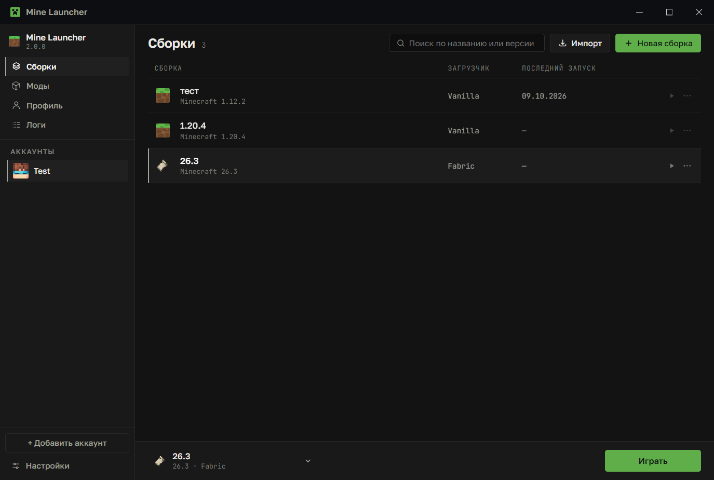

# Mine Launcher

[](https://github.com/gitbrou/minecraft-launcher/releases/latest)
[](LICENSE)
[](https://github.com/gitbrou/minecraft-launcher/releases/latest)

Лаунчер Minecraft, который я написал для себя. Мне надоело каждый раз выяснять, какая Java
нужна для 1.12.2, и раскладывать моды по папкам вручную — теперь это делает лаунчер.

Лаунчеров и так много, но мне не хватало простого: отдельных сборок, которые не дублируют
библиотеки, установки модов с Modrinth в два клика и чтобы про Java можно было не думать.



## Скачать

Windows: скачай установщик из последнего релиза. Подписи нет, поэтому SmartScreen
предупредит, что файл опасный: «Подробнее» → «Выполнить в любом случае». После установки
лаунчер сам проверит обновления и дальше будет обновляться в фоне.

macOS и Linux: в том же релизе лежат dmg и AppImage. Проверял их мало, так что если
что-то не заведётся, пиши в issues — будем разбираться.

## Как играть

Добавь ник (пока только оффлайн), создай сборку и выбери версию игры с загрузчиком. Дальше
можно поставить моды во вкладке «Моды» или сразу нажать «Играть».

Первый запуск долгий: скачиваются Java, библиотеки и ассеты. Это нормально, второй запуск
заметно быстрее.

## Собрать самому

Нужен Node.js 18+ и npm. Из корня репозитория:

```bash
cd mine-launcher
npm install
npm run dev
```

`npm test` — 65 тестов, `npm run lint` — eslint, `npm run build` — установщик и portable
в `dist-build/`. Сборка под Windows получается сразу, для macOS и Linux нужна своя система.

## Где данные

`%APPDATA%\mine-launcher\.mine-launcher` на Windows, на других системах — стандартный
`userData`. Внутри `accounts.json`, `instances.json`, `settings.json` и папки с версиями,
библиотеками и скинами. Там же лежат миры, так что целиком папку лучше не удалять.

## Версии

- 2.0.0 — новый интерфейс и автообновления.
- 1.1.0 — импорт по ссылке `minelauncher://import`.
- 1.0.0 — первый релиз.

## Ещё

Сборку можно выгрузить в zip и отдать другу: он импортирует её кнопкой «Импорт» или
ссылкой `minelauncher://import?url=…`. Скин загружается PNG-файлом или скачивается по
нику, посмотреть можно в 3D.

Логи пишутся вживую; если игра упадёт, лаунчер попробует объяснить, чего не хватило.
Баги и идеи — в issues. Код под MIT, делай что хочешь.

---

<p align="center">
  MIT License · 2026 gitbrou
</p>
