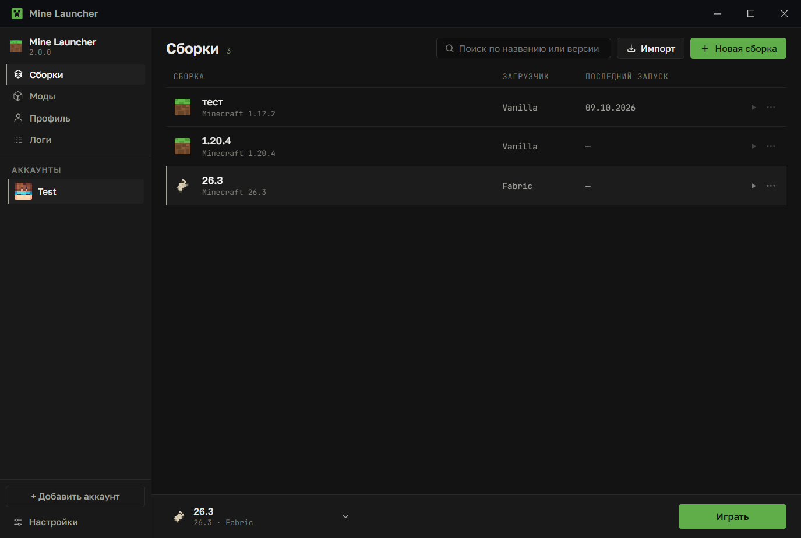

# Mine Launcher

[](https://github.com/gitbrou/minecraft-launcher/releases/latest)
[](LICENSE)
[](https://github.com/gitbrou/minecraft-launcher/releases/latest)

Minecraft-лаунчер для ПК и Android.

На Windows, macOS и Linux это приложение на Electron и React: аккаунты, сборки, моды, скины,
миры и автообновление. На Android — наш интерфейс на базе Zalith Launcher 2: те же аккаунты
и сборки, экранные кнопки и управление из игры.



## Возможности

- Оффлайн-аккаунты и вход через Microsoft.
- Сборки vanilla, Fabric и Quilt, моды с Modrinth.
- Скины, миры, импорт сборки по ссылке.
- Два движка на ПК, переключаются в настройках:
  - **Horizon** — клиент Minecraft 26.3, написанный на Rust. Работает с версией 26.3 и
    запускается без входа в Microsoft: одиночная игра и LAN. Для онлайн-серверов и скинов
    нужен аккаунт Microsoft с купленной Java Edition.
  - **Java** — обычный Minecraft: другие версии, Fabric, Quilt и моды с Modrinth.
- Android: оффлайн-аккаунты, сборки, экранные кнопки, автообновление APK.

Horizon идёт внутри установщика ПК, отдельно скачивать его не нужно. При сборке бинарник
берётся из официального релиза Horizon и сверяется по SHA256.

## Скачать

Готовые файлы: [releases](https://github.com/gitbrou/minecraft-launcher/releases/latest).

- ПК: `mine-launcher-2.1.0-setup-x64.exe` или `mine-launcher-2.1.0-portable-x64.exe`.
- Android: `MineLauncher-1.0.4-arm64-v8a.apk`. Если устройство не ставит arm64-сборку,
  берите `MineLauncher-1.0.4.apk`.

## Сборка

ПК:

```bash
npm install
npm run dev
npm run build
```

`npm run build` скачивает launcher Horizon с GitHub, проверяет SHA256 и кладёт его в
установщик. Нужен доступ к GitHub. Проверки: `npm test`, `npm run lint`.

Android:

```bash
cd android
./gradlew ZalithLauncher:assembleRelease -Darch=arm64-v8a
```

APK собирается в `android/ZalithLauncher/build/outputs/apk/release/`.

## Данные

На ПК аккаунты, сборки, настройки, версии, скины и миры лежат в
`%APPDATA%\mine-launcher\.mine-launcher`. На macOS это
`~/Library/Application Support/mine-launcher/.mine-launcher`, на Linux —
`~/.config/mine-launcher/.mine-launcher` или `$XDG_CONFIG_HOME/mine-launcher/.mine-launcher`.
Игра, запущенная через Horizon, хранит миры и настройки отдельно, в `%APPDATA%\horizon`.

## Структура

- `electron/` — главный процесс, IPC, запуск Java и Horizon.
- `src/` — интерфейс на React.
- `android/` — Android-версия на базе Zalith Launcher 2.
- `scripts/fetch-horizon.mjs` — загрузка launcher Horizon для сборки.

## Версии

- 2.1.0 — текущая версия для ПК, APK 1.0.4.
- 2.0.0 — новый интерфейс, импорт по ссылке, автообновление.
- 1.1.0 — исправления.
- 1.0.0 — первый релиз.

## Лицензии

ПК-часть распространяется по MIT (см. `LICENSE`). Android-часть сделана на базе
[Zalith Launcher 2](https://github.com/ZalithLauncher/ZalithLauncher2) и распространяется
по GPL-3.0; исходники лежат в `android/`.

<p align="center">2026 gitbrou</p>
